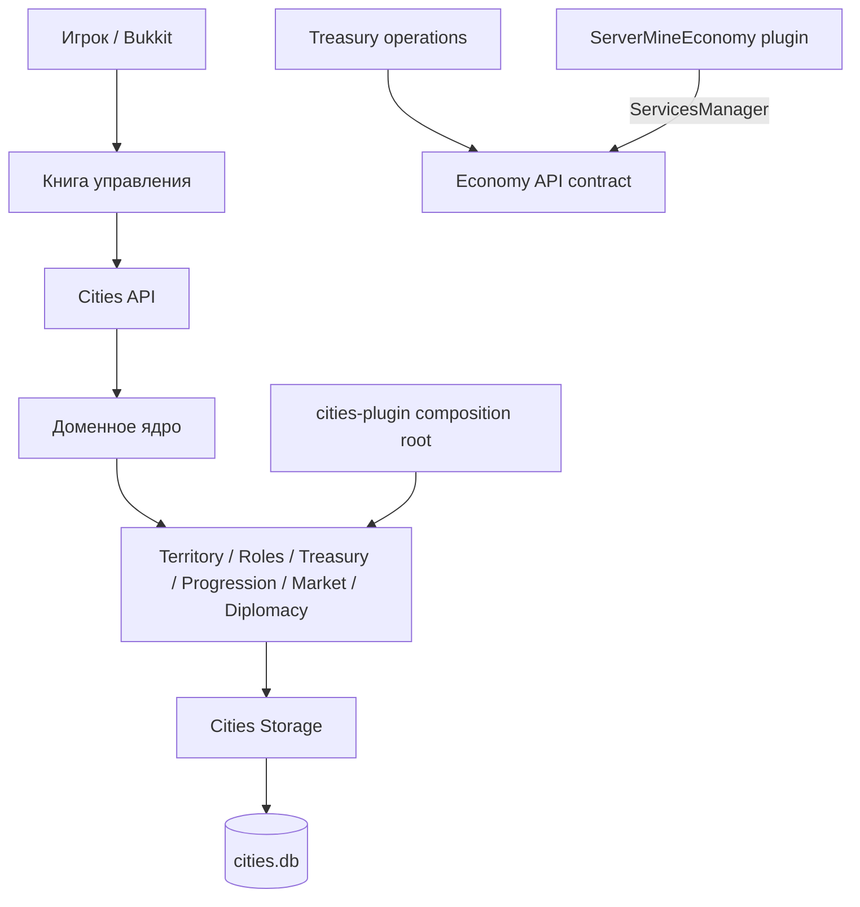

# Архитектура ServerMineCities

ServerMineCities — самостоятельный серверный плагин, собранный из внутренних модулей Cities. Для денежных операций он использует опубликованный Bukkit-сервис `EconomyService` от отдельного обязательного плагина `ServerMineEconomy`.

`cities-plugin` — единственная точка входа с `plugin.yml`; он объединяет внутренние модули в один `ServerMineCities` JAR. Economy API включён в исходный репозиторий как `compileOnly` контракт для компиляции и не упаковывается в Cities JAR. Внутренние модули не устанавливаются как отдельные плагины.

Городские данные принадлежат SQLite `cities.db`; Cities не читает и не изменяет базу Economy. Физические деньги и резервы обрабатываются только через Economy API. Операции, затрагивающие обе системы, используют стабильный operation ID и состояния восстановления.

Публичный API состоит из неизменяемых моделей и интерфейсов. `CityRepository` отделяет доменную модель от SQLite. GUI получает срезы через сервисы и повторно проверяет право, ревизию и доступность цели при подтверждении.

Более подробные зависимости модулей приведены в [границах модулей](module-boundaries.md), а денежные инварианты — в [правилах транзакций](transactions.md).
